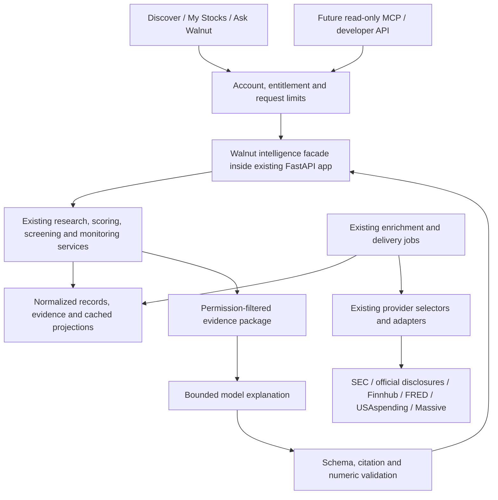

# Walnut 2.0 implementation proposal

Prepared November 14, 2026, America/Denver. **Architecture, UX and phased plan approved November 15, 2026.** FMP migration remains the immediate engineering priority. The integrated order below extends [the product roadmap](roadmap.md); it does not establish a second competing roadmap.

Walnut should organize its existing research around three questions: what deserves attention, what changed in my stocks, and what can Walnut investigate for me. The recommended first product release is a simpler entrance to the existing application, followed by a bounded intelligence service. Preserve the data engines, historical records, routes, plans, and delivery controls.

## Evidence and scope

The primary checkout is `b7989115`, 613 commits behind locally recorded `origin/main`, with extensive unrelated edits. It is not a safe application baseline. This audit inspected the current migration worktree `artifacts/release-common-equity-proof-nov9`, based on `4e0b68c2d1786df55ca68b20fcd32c6daf752a8c`, including its uncommitted common-equity changes. The root checkout's current documentation supplies the more recent operational record. Local `origin/main` is not a fresh GitHub or deployment verification.

Evidence labels used here:

- **Implemented:** present in inspected source. This alone does not establish current production behavior.
- **Historically verified:** a dated release or operational receipt exists. Recheck live state before a cutover.
- **Partial:** implementation or limited evidence exists, but the full user promise is not accepted.
- **Proposed:** new work requiring review.

No Walnut 2.0 application code, route, schema, model configuration, recurring schedule, pricing, subscription, or production data changed during this proposal. Migration validation is reported separately in [the November 14 checkpoint](migration-audit-2026-11-14.md).

## 1. What Walnut already has

| Capability | Actual implementation and reuse | Boundary |
| --- | --- | --- |
| Application and access | Next.js frontend, FastAPI/SQLAlchemy backend, account/plan controls in `backend/app/entitlements.py`, current API client and server projections | Keep Free, Premium, Pro and admin behavior. A new conversational route must not bypass the existing projections. |
| Evidence collection | Official Congress and SEC adapters, normalized activity, provider selectors, caches, staging and publication controls | Collection, qualification, publication and consumer acceptance are separate states. |
| Research and discovery | `confirmation_score.py`, `confirmation_context.py`, `top_stocks.py`, `screener.py`, `cross_source_divergence.py`, research briefs | Reuse score, rank order, calculations and source limits. A combined opportunity explanation and its eligibility policy are new. |
| Ticker research | Existing ticker context, prices/charts, financials, news, ownership, transcripts, valuation and research views | Coverage differs by provider and issuer. A successful page is not proof every section is available. |
| Research Memory | `research_memory.py` stores structured claims, risks, catalysts and invalidators; `research_evidence.py` stores source documents/events; `research_claim_matching.py` performs deterministic and bounded semantic matching | The inspected serializer still says continuous evidence monitoring is a future phase. Premium entitlement is present; end-to-end continuous thesis delivery remains partial. |
| Monitoring and delivery | `confirmation_monitoring.py`, `monitoring_alerts.py`, `watchlist_content_events.py`, `watchlist_delivery.py`, custom rules, saved-screen monitoring, intraday and digest builders | Existing notification paths are reusable. A unified material-change briefing, reliable thesis delivery and complete replacement-provider coverage are not yet established. |
| Historical evidence | `outcome_integrity.py` and `outcome_ledger.py`, canonical entries, adjusted prices, provenance and horizon observations | Ledger horizons are explicitly 7, 30, 90, 180 and 365 days. General backtesting and Signal Mixer have separate methods and limitations. Do not describe them all as certified results. |
| Operations | Provider usage audit, enrichment queue, freshness/cache warming, feature flags, release workflows, request auditing | Preserve serialized heavy work and current host topology. A second queue or scheduler is unnecessary initially. |
| SEO and acquisition | Public ticker/entity/research pages, canonical URLs, sitemaps, research discovery and analytics | Preserve public pages and approved October 31 hero. Verified customer activation/payment reconciliation remains incomplete. |

Research Memory already uses structured model output and the Responses API. Claim matching has a per-run budget, defaulting to 30 semantic calls. Existing brief generation defaults to `gpt-6.1-sol`; thesis/evidence/matching source defaults remain `gpt-5.4-mini`. These are source defaults, not freshly inspected account settings. There is no reason to replace all these pipelines to add Ask Walnut.

## 2. Migration status and critical path

The fresh source-only audit finds **72 distinct literal endpoint paths across 32 FMP-referencing modules**, down from 74 in the October 16 audit. The two absent paths are the removed balance-sheet-growth and cash-flow-growth requests. These counts include registry defaults, optional branches and unused helpers. They are **not 72 active dependencies or a measured traffic count**. Dynamic expressions and database overrides require runtime inspection. The full grouped inventory appears below.

**Provider access is a separate blocker:** the [November 6 investigation](confirmation-forward-provider-hold-2026-11-06.md) records an explicit FMP “Account suspended” response. No restored access was verified in this audit. “FMP selected” therefore must not be read as “FMP healthy,” and an FMP rollback cannot be assumed to restore fresh data. Preserve caches and expose stale/unavailable states while following the existing account-resolution workflow. Separately, the [November 14 frozen study](confirmation-forward-study-progress-2026-11-14.md) records 28 successful Massive requests and 208/225 requested observations. That is useful historical-price access evidence, with omissions; it does not establish public quote/snapshot entitlement, commercial rights or full product cutover.

| Domain | Latest evidenced position | What remains before completion |
| --- | --- | --- |
| Congress | Official House and guarded Senate source paths historically selected | Held disclosures, identity/date preservation, rollover/freshness and complete ordinary consumer verification |
| Insider activity | SEC Form 4 historically selected with canonical repair and repeat receipts | Backlog/holds, new filings and all retained monitoring/digest consumers |
| News, press, filing lists, company metadata | Finnhub news, SEC press and SEC metadata/filing readers historically selected | Broad listing coverage, freshness, source ownership, research consumers and remaining price/market-cap reference paths |
| Financial history | SEC historical statement readers selected in recorded releases | Foreign and combined issuers, statement ownership, periods/currency, omissions and ordinary rotation; discovery collection enabled while its new reader remains disabled |
| Core fundamentals | Replacement preparation and many source proofs implemented; last verified selection remains FMP | Full supported-universe classification/metric coverage, score and alert rebaseline, screener/comparison/rankings, schedule and capacity acceptance |
| Common equity | Local PPLC whole-statement qualification restores ROE while retaining seven previous values; 34 isolated checks pass and fresh 49-scope replay preserves every prior output/request | Exact final regression, Linux resource-bound fixture, release/installed verification and ordinary refresh. It remains uncommitted and undeployed. |
| Institutions | Complete captured 6,472-source replay and identical repeat found; captured consumer acceptance exists with 1,826 eligible events | Exact intended-release consumer proof, current cohort/live operation, ownership denominators, ranking/daily/weekly dependencies and sustained publication capacity. Publication remains off in the latest deployment record. |
| Calendar and analysts | Direct/BLS and Finnhub earnings calendar; monthly recommendation counts historically selected | Monthly counts are not individual upgrades, price targets or forward estimates. IPO/dividend/split calendar kinds, economic consensus and paid forecast coverage need explicit decisions/proofs. |
| Transcripts | Issuer/SEC readers and integrity/freshness guards implemented | Broad issuer/quarter coverage, remaining inaccessible sources, live scheduled research consumers. Last recorded global selector remains FMP. |
| Prices and corporate actions | Massive PR805 preparation, adjusted-history/quote consumers, delayed-close rules and PostgreSQL timestamp rehearsal | Final merge/release reconciliation, additive schema sequencing, actual plan entitlement/rights, complete history/actions/benchmark coverage, cache warming and ordinary alert/ranking/outcome verification |
| Valuation and specialist fields | Consumer guards and reduced requests implemented | Proprietary FMP DCF and analyst targets are unresolved semantics. Free statements or a forecast subscription do not recreate a vendor DCF. No silent removal or new valuation model is authorized. |
| Macro/contracts | Existing FRED cache and USAspending integration can supply these domains | Recheck freshness and issuer mapping; ETF proxies must remain explicitly identified as proxies |
| Global shutdown and billing | Transport guards exist | Final selected-source traffic evidence across all jobs/fallbacks, customer acceptance, written cancellation/access-end confirmation and retained-data terms |

The institutional continuation metadata needs reconciliation: the inspected current-release helper pins `ffcc1e35`, while the last narrative describes `45115e7e`; an older waiting receipt also names a different run from the completed active run. Do not execute an old helper or call it current-release acceptance without checking its code, source hashes, run ownership and target. A completed frozen replay does not authorize live publication.

**Priority within the existing migration:** finish the shared financial qualification and ordinary freshness work; reconcile frozen institutional acceptance to the final intended release; complete all affected consumer proofs; close transcript/analyst/calendar/valuation gaps explicitly; then finish Massive prices and corporate actions; finally prove zero FMP traffic and handle billing through the existing authorization gate. Keep reliability remediation ahead of any cutover.

Historical dependencies deserve their own acceptance matrix: ticker history, benchmarks, delisted securities, splits, dividends, strategy/portfolio curves, recorded score snapshots and every Ledger horizon. Starter's advertised five-year history cannot be assumed to replace every older record. Preserve retained history subject to applicable rights, and show unsupported periods as unavailable.

## 3. Architecture with minimal duplication



Keep the intelligence facade in the existing application process. Internal Python service calls should reuse normalized readers without making HTTP requests back into Walnut. UI and future MCP clients receive the same validated, permission-filtered result. No model tool calls a vendor directly. Reuse the actual domain selectors and publication controls as well as the registry: old registry defaults are not an authoritative account of active source selection.

Proposed small additions, after approval:

| Proposed change | Existing anchor | Responsibility |
| --- | --- | --- |
| `backend/app/services/intelligence.py` | Research evidence, context, rankings, screener and comparison services | Read-only composition of six initial research operations; bounded filters, dates and output sizes |
| `backend/app/schemas/intelligence.py` | Existing response/schema conventions | Shared response and query contracts, explicit coverage and evidence references |
| `backend/app/routers/intelligence.py` | Existing authentication and entitlement enforcement | First-party read endpoints and a bounded Ask request endpoint; no vendor configuration exposure |
| Small additions to evidence/matching/delivery services | Existing event IDs, matches, alerts and digest builders | Materiality rules, source revision handling, scheduled thesis updates and personalized assembly |
| `frontend/components/intelligence/` | Existing ticker, research, watchlist and monitoring components | Shared briefing, evidence, coverage and question UI; preserve detailed tools |

Start with existing evidence and alert tables. Add a versioned intelligence-result cache and request/quality metadata only where current tables cannot represent them cleanly. Do not duplicate canonical events or create a second user/watchlist model. A cache is disposable; canonical research evidence and recorded outcomes are not.

Each intelligence result should include: result ID, scope/query, security IDs, data cutoff, generated time, last successful refresh, coverage state, facts, interpretations, risks, watch-next items, source references, calculation/methodology versions, model/prompt versions and limitations. Evidence references resolve to stored source IDs/URLs and locators with publication, event and first-available timestamps. Reject unsupported source references and unit/currency mismatches.

Cache shared factual summaries by evidence revision, calculation version, access projection and requested period. Personal overlays also include user/thesis revision. Apply authorization before model input and again on response. Never share private thesis text in a cross-user cache. Source corrections invalidate derived summaries without rewriting recorded outcomes or disguising a correction as new activity.

## 4. Product design and user journeys

The primary navigation becomes **Discover | My Stocks | Ask Walnut**, with Advanced Research, search, inbox and account controls remaining reachable. Prefer additive `/discover`, `/my-stocks` and `/ask` routes, then make Discover the signed-in default only after route compatibility is tested. Keep `/`, `/?mode=all`, `/feed`, existing deep links and public canonical behavior intact until that compatibility design is accepted. Do not repurpose an indexed route casually.

| Screen | Recommended layout, top to bottom | Main action and empty states |
| --- | --- | --- |
| Discover | Prominent Ask input; brief personalized overview; important changes in followed stocks; qualifying opportunities; Advanced Research links | Open evidence, then follow a stock. If nothing qualifies, say so. Distinguish no qualifying opportunities from stale or incomplete coverage. |
| My Stocks | Search/add stock; material changes since last visit; compact watched-stock list with last checked/coverage; upcoming known events; thesis section; notification preferences | Read the change, inspect evidence, adjust monitoring or save a thesis. A successful quiet check says no material changes; a failed check says coverage delayed. |
| Ask Walnut | Question input and a few task examples; interpreted scope; concise findings; evidence/counterevidence; sources/dates; follow-up actions | Compare, open ticker, save/follow through existing explicit actions. Unsupported requests explain the missing scope. Do not silently widen a question or invent a result. |

An opportunity uses seven fields: what happened, why it merits attention, supporting evidence, counterevidence, risks, what to watch, and historical context only when the existing certified method supports it. Show the existing 30-day Confirmation Score with its timestamp and coverage. Avoid buy/sell commands, return probabilities or new horizon scores.

Example layout, with labels rather than invented market findings:

```text
Discover        My Stocks        Ask Walnut          Advanced Research
[ Ask about a company, a change, or a research question              ]

Your briefing                        As of [time] · [coverage]
[One concise overview, composed from the sections below]

Changes in stocks you follow
[Company] [What changed] [Why it may matter] [Evidence] [Open]

Opportunities to investigate
[Company] [Supporting evidence] [Counterevidence] [Watch next] [Follow]
```

On mobile, use the same three destinations with labeled navigation and a single content column. Keep the primary question input at the top of Discover and a persistent clear way to return to it. Collapse long supporting evidence behind an accessible disclosure, not a new maze of tabs. Existing Feed remains the approved table experience; opportunity cards belong to Discover rather than replacing Feed.

Three initial journeys:

1. **New visitor:** public ticker or published brief → understand one sourced finding → follow/save → existing sign-in flow → return to the same company with action intent preserved. Begin the public preview with already published/cached permitted content, not unrestricted anonymous model requests.
2. **Returning member:** My Stocks → one material update → inspect original evidence → optionally update a thesis or notification preference. Show last successful evaluation so silence is interpretable.
3. **Research question:** “Compare NVDA, AMD and AVGO” → validated symbols, period and metrics → existing deterministic comparison → explanation with citations → existing comparison/ticker detail → follow. A query asking for unavailable institutional coverage must disclose the gap.

## 5. Existing-feature mapping

These are contextual entrances, not route deletions or entitlement changes.

| Existing feature | Primary home in Walnut 2.0 | Retained detail |
| --- | --- | --- |
| Feed, including filters and exports | Discover → Advanced Research → Activity Feed | Existing root/feed routes, table layout, Pro sort/export and paid page-size rules |
| Signals, Top Stocks, rankings | Discover opportunity inputs and deeper evidence | `/signals`, `/top-stocks`; Top 10 and guest/Free/paid visibility unchanged |
| Screener and saved screens | Discover → Advanced Research; Ask structured filters | `/screener`, saved-screen monitoring and current limits |
| Ticker Intelligence and all ticker panels | Detail destination from all three experiences | `/ticker/[symbol]`, chart, financials, news, filings, transcripts, valuation and research |
| Congressional trading and member portfolios | Discover source evidence; My Stocks followed entities | `/congress-trades`, `/members`, `/member/[slug]` |
| Insider trading and profiles | Discover source evidence; My Stocks followed entities | `/insiders`, `/insider/[slug]` |
| Institutional holdings/filings | Discover source evidence; My Stocks within entitlement | `/institutions`, `/institution/[cik]`, `/institutional-filings` |
| Government contracts/departments | Discover source evidence; My Stocks company/department monitoring | `/government-contracts`, `/departments`, department profiles |
| Strategies and subscriptions | Discover → Advanced Research; My Stocks followed strategies | `/strategies`, methodology and detail pages |
| Backtesting and Signal Mixer | Advanced Research, linked from relevant historical context | `/backtesting`, `/signal-mixer`; distinguish their methods from the Ledger |
| Market Pressure and macro positioning | Discover contextual overview and Advanced Research | `/market-pressure`, `/feed/macro-positioning`; preserve proxy labels |
| Insights and public research | Discover reading/explanation links | `/insights`, categories, `/research` and canonical article URLs |
| Compare | Ask and ticker contextual action; Advanced Research | `/compare` and existing symbol routes |
| Leaderboards and Congress trader rankings | Discover → Advanced Research | `/leaderboards` and child routes |
| Watchlists | My Stocks | `/watchlists` and list detail; preserve IDs, members, defaults and limits |
| Inbox, monitoring, custom rules and calendar | My Stocks; global inbox shortcut | `/monitoring`, current read state, delivery identities, rules and preferences |
| Research Memory | My Stocks → Thesis; Ask permitted thesis questions | `/monitoring/research` and detail; Premium/Pro rules remain |
| Outcomes Ledger | Evidence links in Discover/Ask; Advanced Research | `/outcomes`; Free ten-row preview and Premium navigation/sort/size rules remain |
| Email notifications and digests | My Stocks notification preferences | Existing opt-in, master preferences, unsubscribe, deduplication and schedules |
| Options and retirement calculators | Advanced Research → Calculators | Existing calculator routes, formulas and limitations |
| Search, profiles directory, onboarding | Global search and contextual onboarding | `/search`, `/profiles`, `/welcome`, public discovery pages |
| Account, pricing, billing, support and legal | Account/footer | Current plans, prices, checkout and policy URLs unchanged |
| Admin, SEO and editorial operations | Existing admin area | No admin capability exposed through Ask; no new automatic publication |

## 6. AI orchestration, grounding and costs

Use one bounded orchestration path. The model may select an allowlisted structured query; server code validates and executes it under the requesting user's access. Begin with analyze stock, find opportunities, get activity, compare stocks, get monitoring updates and get thesis changes. Each operation has bounded symbols, time range, pagination, supported metrics and timeout. No arbitrary SQL, code execution, unrestricted URL fetching or autonomous trading.

Recommended sequence: classify intent → validate query/access → read cached normalized evidence → perform deterministic calculations → assemble permission-filtered evidence → generate a short explanation → validate citations/numbers/schema → return or show a truthful fallback. Strict function schemas reduce malformed arguments but do not establish factual correctness; application validation remains necessary. [Official function-calling documentation](https://developers.openai.com/api/docs/guides/function-calling).

Reuse the current Responses integration and `openai_request_audit.py`. Start quality evaluation with the existing Sol editorial model and current research task models; do not change production model defaults as part of planning. Evaluate a cheaper model for constrained extraction/routing later using held-out grounding, access and latency cases. No model is needed for arithmetic, routine threshold detection, unchanged inputs or many zero-result responses.

For monitoring, deterministic evidence adapters run first. Materiality rules should be explicit by event type, with versioned thresholds and available denominators. Examples: count open-market purchases separately from grants/exercises; report size relative to holdings only when holdings are supported; treat a 13F as a dated disclosure, not a real-time purchase; distinguish contract obligations from award ceiling; distinguish corrected data from a new business event. Use semantic matching only for relevant claims/documents after deterministic filtering.

Generate one shared factual explanation per material evidence revision. Assemble personal relevance and daily/weekly briefings from these results. Preserve the user's thesis as an interpretation and label supporting/contradicting evidence; never call an investment thesis verified merely because a model agrees. Extend existing matching and delivery jobs with idempotent processing and resumable cursors rather than running an autonomous agent continuously for every user.

Initial proposed controls: at most three query rounds per Ask request, bounded evidence package, 1,000 output-token target, per-user daily token/call limits, global daily spend ceiling, concurrency cap and a deadline with partial-result handling. Set monetary limits only after approving the pilot size. Track retries, failed calls and reasoning/output usage in actual costs. Cache facts separately from private conversation history. On a budget or source failure, serve valid cached evidence with its age or report unavailable; do not fill gaps using model memory.

Treat source text as untrusted content. Whitelist source identifiers, escape rendered output, enforce object ownership and plan limits in every tool, and exclude secrets and unnecessary personal data from prompts/logs. Persist only the conversation needed for the product, with retention/deletion rules reviewed before launch. A stored conversation must be reauthorized after a plan change.

MCP is a later adapter over these same operations. Before implementation, review the then-current ChatGPT distribution requirements, OAuth/scopes, per-tool authorization, rate limits, revocation, logs, permitted data redistribution and adversarial tool arguments. Do not build a separate “plugin backend” now or promise acceptance into a directory.

## 7. Integrated sequence and measurable release gates

Time ranges below are planning estimates for one engineering stream after dependencies are available, not delivery promises. Source coverage and third-party rights make a reliable Phase 1 completion date unavailable today.

| Phase | Exact proposed work and dependencies | Acceptance and rollback |
| --- | --- | --- |
| 0: audit and design, now | Reconcile current release/source inventory; finish proposal, route map, costs and measurement definitions. Continue authorized migration validation. | Every major feature mapped; unknowns explicitly assigned; owner reviews architecture/UX/sequence. No Walnut 2.0 code rollout. |
| 1: critical migration, current priority | Finish shared financial proof and ordinary rotation; bind institutional consumer replay to final release; resolve free-source and paid semantic gaps; Massive last; warm caches and run full consumer matrix; verify global FMP transport before billing action. | Exact-source/repeat integrity, no historical identity changes, required freshness/coverage per capability, all affected entitlement/delivery paths, sustained load over market/overnight/weekend windows. Per-domain switch and preserved old reader/configuration support rollback while licensed access exists. |
| 2: simplified shell, roughly 1–2 weeks after approval/gates | Add three routes and primary nav; compose existing cached panels; keep Advanced Research/deep links; build shared evidence/coverage UI. Ship Ask publicly only when it can fulfill its promise; use an internal preview until Phase 3. | All mapped features reachable; route/query/canonical regression matrix; mobile 360/390 px and desktop QA; no plan leaks or changed Feed controls; five-person usability check with at least four completing research→follow unassisted. Disable UI flags to restore prior nav/default. |
| 3A: intelligence/monitoring, roughly 2–3 weeks | Add facade and response contract; define evidence-bound materiality; connect existing matching jobs to durable thesis updates/inbox; assemble personal briefings. Requires qualified input domains. | Every factual claim traceable; every computation reproducible; correction/retry produces no duplicate update; missed-job recovery proven; truthful quiet/degraded states; all account ownership/plan tests pass. Delivery stays held until no-send and schedule acceptance. Disable new generation/delivery while preserving old alert paths. |
| 3B: Ask, roughly 1–2 additional weeks | Add allowlisted query planning, explanation and validation; reuse facade, cache, audit and entitlement controls. Can be developed alongside 3A after contracts stabilize. | Proposed 100-case frozen evaluation includes missing/stale data, ambiguity, conflicting sources, adversarial documents and unauthorized requests. Zero critical numeric/citation/access failures; at least 90% task completion on supported questions; p95 initial cached evidence under 2 seconds and complete bounded answer under 12 seconds at pilot load. Failures trigger fallback, not unsupported text. Disable Ask flag independently. |
| 4: distribution and economics, staged 4–6 week measurement window | Test onboarding and contextual upgrade timing; reconcile first-party metrics; evaluate positioning using GSC/activation evidence. Scope MCP only after API stability and rights review. | Measurable external activation/return improvement without data-quality, unsubscribe or margin regression. Require sufficient cohort size; no causal claim from a handful of clicks. Roll back the experiment independently; no pricing experiment without separate approval. |

Across all phases, require public cached-route p95 no worse than the measured baseline by more than 10%, no passive-view vendor/model calls on the new surfaces, and no new material job starvation. These are proposed launch budgets, not measurements already achieved. Source-specific freshness limits must remain the existing stricter limits where applicable.

Parallelizable now: UX sketches, route inventory, schema design on paper, evaluation case design, cost scenarios and measurement reconciliation planning. These do not depend on the final vendor switch. After approval: shell work and query/grounding fixtures can overlap without competing with migration jobs. Do not combine a provider activation, navigation change and new delivery schedule into one release.

## 8. Cost assessment

An exact current monthly total is **not established**. The owner reported roughly $600/month for FMP, and the latest recorded Fly invoice is $61.94; these are dated evidence, not a newly reconciled November bill. Vercel, Postmark, OpenAI, storage/backup and any remaining Creatomate charge need current invoice/usage reconciliation. Previously reported Zeely/Kling/ElevenLabs cancellations are not new refunds or savings in this proposal.

| Cost | Current evidence | Planning treatment |
| --- | --- | --- |
| FMP | Approximately $600/month reported; cancellation not verified | Retain until technical and billing gates close. Do not assume the old proposed November 12 end date occurred. |
| Fly infrastructure | Last recorded actual invoice $61.94; consolidated database plus combined API/data/alerts host | Hold topology and use $61.94 only as a historical reference. Free-source parsing still consumes CPU and storage. |
| Massive Stocks | Current public Starter $29/month, five years, 15-minute delayed data | Conditional adapter/subscription scenario, not proof of Walnut's permitted customer display or account entitlement. |
| SEC/official/FRED/USAspending | No new vendor subscription proposed | Nonzero engineering, storage, scheduling and operational costs. |
| Finnhub | Existing free key; paid packages not purchased in the record | Preserve partial coverage labels. Current public pricing could not be extracted during this audit; do not reuse an old paid quote as current. |
| AI | Actual current usage not reconciled | Meter by feature and accepted result; control duplicated generation and unbounded calls. |

Massive's public terms now expressly distinguish personal, non-business use from business use. Its stock page lists commercial/display rights separately. Keep Massive as the selected implementation target, but confirm Walnut's intended rights before customer redistribution or MCP exposure. The $29 case must not be presented as a settled commercial operating budget. No purchase or provider change is proposed here. [Massive Stocks](https://massive.com/stocks), [Massive terms](https://massive.com/legal/terms).

Illustrative monthly arithmetic, excluding tax, unknown services, labor, paid gaps and rights-dependent charges:

- Historical FMP plus Fly reference: $600 + $61.94 = **$661.94**.
- Conditional post-FMP reference with $29 Starter: $29 + $61.94 = **$90.94**, nominal difference **$571** before AI and other costs.
- While FMP overlaps with Starter: **$690.94** before AI/other costs. No realized saving until the final FMP charge is known.

For a conservative illustration using the current editorial model, official standard short-context Sol rates are $2 per million input tokens and $10 per million output tokens. A 3,000-input/1,000-output request costs $0.016; 1,500 shared 4,000-input/600-output briefs cost $21. [OpenAI pricing](https://developers.openai.com/api/docs/pricing).

| Illustrative volume | Ask cost | Shared briefs | Incremental total |
| --- | ---: | ---: | ---: |
| 100 active users × 10 uncached answers/month | $16 | $21 | $37 |
| 1,000 active users × 10 uncached answers/month | $160 | $21 | $181 |
| 1,000 active users × 30 uncached answers/month | $480 | $21 | $501 |

These examples assume the stated total billed tokens, one bounded explanation per answer and no extra paid tools. Retries, extra reasoning tokens, multiple model rounds and existing research workloads increase cost; reuse reduces it. At the middle example the conditional infrastructure/provider/AI subtotal becomes $271.94, before all exclusions. This illustrates why “cheap market data” alone does not establish low total operating cost. Set approved quotas against actual gross margin and measured token usage, without changing current plan prices.

## 9. Risks and simpler alternatives

| Risk | Concrete control |
| --- | --- |
| Incorrect source equivalence or financial periods | Source-bound proofs, issuer/currency/period checks, explicit unavailable states and capability-level cutover gates |
| Historical result corruption | Preserve entry/exit method, split-adjusted inputs, first-available timestamps, canonical IDs and recorded snapshots; never reprice history through an implicit provider fallback |
| Alert floods or suppressed real changes | Stable event/version identities, separate correction/rebaseline policy, replay and once-only delivery, opted-in no-send rehearsals |
| Quiet monitoring mistaken for complete coverage | Last successful check, per-source coverage and degraded states; distinguish zero events from absent evidence |
| API latency and CPU exhaustion | Cache-only foreground composition, bounded queues, shared summaries, concurrency/CPU budgets and sustained ordinary workload acceptance |
| Paid/private data leakage | Server-side tool authorization, tenant-scoped personal cache, entitlement-aware shared results and adversarial access tests |
| Unsupported generated claims | Evidence allowlist, deterministic numbers, structured response validation and safe abstention; no inferred missing figures |
| SEO regression | Preserve existing canonicals, redirects, sitemaps, SSR public content and internal links; no mass URL migration or hero change |
| Billing/rights risk | Confirm cancellation notice/access end and data retention; resolve Massive/Finnhub redistribution rights; no plan change without authorization |
| Misleading conversion conclusion | Reconcile actual accounts/saves/returns/live payments, identify internal/test/unidentified activity, publish cohort denominators |
| Long migration hidden by a new UI | Publish per-capability status; new navigation does not change data readiness. Keep the migration critical path explicit. |

Do not build now: a microservice split, Kafka/event bus, a second provider abstraction, a new vector database for structured stock questions, multi-agent research swarms, a model-calculated score, a score per horizon, a replacement backtest engine, unlimited anonymous AI, real-time trading/broker execution, mobile native apps, an early MCP marketplace launch, automated social/video content, or new pricing tiers. Use existing SQL filters and source locators first; add semantic retrieval only when measured failed questions justify it.

Do not force daily opportunities or alerts. A useful quiet product is preferable to invented urgency. Do not hide existing data tools or cut features to make the interface appear simpler.

## 10. Success criteria and measurement

Use first-party successful actions as the source of truth, joined to privacy/consent-aware analytics where permitted. Preserve an explicit unidentified bucket. Revenue means a positive live paid invoice, excluding test mode, internal accounts and grants.

| Metric | Definition | Proposed decision rule |
| --- | --- | --- |
| Activation | New verified external account completes a sourced research view and a successful save/follow within seven days | Establish a clean baseline; target +20% relative improvement over a comparable cohort, with counts/uncertainty reported |
| Time to value | Time from first eligible visit to first useful evidence view and completed follow | Median under 3 minutes in moderated onboarding; then measure real traffic |
| Retention | D7 and D30 return to research or monitoring among activated accounts eligible for the full window | Target +15% relative improvement; do not include immature cohorts |
| Monitoring usefulness | Weekly active monitors that inspect a delivered material update; sampled useful/not-useful feedback | At least 80% useful in the reviewed pilot, with false positives and coverage failures reported separately |
| Ask quality | Supported task completion, factual/citation/numeric accuracy, abstention and p95 latency | Frozen evaluation gates above; zero critical access/calculation defects; no “accuracy” inferred from schema validity |
| Paid conversion | First positive live subscription within 30 days of eligible external activation | Target +15% relative improvement after a clean baseline, without treating tiny counts as proof |
| Engagement | Evidence opened, completed follow, thesis reviewed/updated, repeat useful research | Favor completed research/monitoring actions over page views, prompt count or email opens |
| Data quality | Coverage/freshness by capability and issuer, correction rate, duplicate rate, job lag | Zero duplicate canonical identities; no silent substitution; all displayed factual claims source-linked; existing freshness gates preserved |
| Economics | Provider + infrastructure + model + delivery cost per weekly active monitor and per paying account | Approved pilot spend cap; improving contribution margin without a coverage regression |

Instrument proposed result-view, evidence-open, follow-complete, monitoring-update-view, thesis-review, Ask-complete/failure and budget-deferred events. Include result/evidence version, server success, coarse access tier and freshness state, while excluding thesis text and source secrets. Reuse existing activation events where their semantics match instead of double-counting.

The [November 2 growth assessment](growth-review-2026-11-02.md) found only 111 GSC impressions and five clicks in its completed comparison window, with nine of ten cohort pages indexed. Account/payment reconciliation was unavailable, and GA included internal traffic. That evidence supports fixing measurement and the research-to-save journey; it does not support a promise that new hero copy will solve acquisition. Review a fresh GSC and first-party cohort before recommending positioning changes.

## Review decision

Approved November 15, 2026 (America/Denver): the owner agreed to the architecture, Discover/My Stocks/Ask Walnut UX, preservation map and phased implementation plan. Proceed within the approved migration-first sequence and release gates. This approval does not change prices, purchase subscriptions, send customer messages, cancel FMP or activate unverified feeds. Phase 0 planning and the existing FMP work continue; product implementation follows the dependencies in the approved plan. New spending, customer delivery schedules, pricing experiments and MCP distribution retain their separate gates.

## Appendix: current literal FMP endpoint inventory

Generated from the inspected release worktree using the existing AST audit. `/stable/` prefixes are omitted below; the two legacy `/api/v3/` paths are shown in full. This is a source inventory, not live telemetry. See the status matrix above before classifying an endpoint as migrated or active.

| Family | Literal paths |
| --- | --- |
| Legacy company and security reference | `/api/v3/profile/{symbol}`, `/api/v3/search` |
| Earnings and forecasts | `analyst-estimates`, `earnings` |
| Statements and calculated fundamentals | `balance-sheet-statement`, `balance-sheet-statement-ttm`, `cash-flow-statement`, `cash-flow-statement-ttm`, `income-statement`, `income-statement-growth`, `income-statement-ttm`, `key-metrics-ttm`, `ratios`, `ratios-ttm` |
| Prices and market snapshots | `batch-commodity-quotes`, `batch-index-quotes`, `batch-quote`, `historical-chart/1min`, `historical-price-eod/full`, `historical-price-eod/light` |
| Company and security reference | `company-screener`, `market-capitalization`, `market-capitalization-batch`, `profile`, `search-cik`, `search-symbol` |
| Valuation | `custom-discounted-cash-flow` |
| Corporate actions | `dividends`, `splits` |
| Calendars | `dividends-calendar`, `earnings-calendar`, `economic-calendar`, `ipos-calendar`, `splits-calendar` |
| Earnings transcripts | `earning-call-transcript`, `earning-call-transcript-dates` |
| Macro and sectors | `economic-indicators`, `sector-performance-snapshot`, `treasury-rates` |
| Analysts | `grades`, `grades-consensus`, `grades-historical`, `price-target-consensus`, `price-target-news`, `price-target-summary`, `price-target-summary-bulk`, `upgrades-downgrades-consensus-bulk` |
| Congress disclosures | `house-latest`, `senate-latest` |
| Insider trades | `insider-trading/latest`, `insider-trading/search` |
| Institutional filings and analytics | `institutional-holder/latest`, `institutional-holdings/latest`, `institutional-ownership/dates`, `institutional-ownership/extract`, `institutional-ownership/extract-analytics/holder`, `institutional-ownership/holder-industry-breakdown`, `institutional-ownership/holder-performance-summary`, `institutional-ownership/industry-summary`, `institutional-ownership/latest`, `institutional-ownership/symbol-positions-summary`, `shares-float` |
| Index membership | `nasdaq-constituent`, `sp500-constituent` |
| News and press releases | `news/crypto-latest`, `news/forex-latest`, `news/general-latest`, `news/press-releases`, `news/stock`, `news/stock-latest` |
| SEC filing search | `sec-filings-company-search/symbol`, `sec-filings-search/symbol` |

